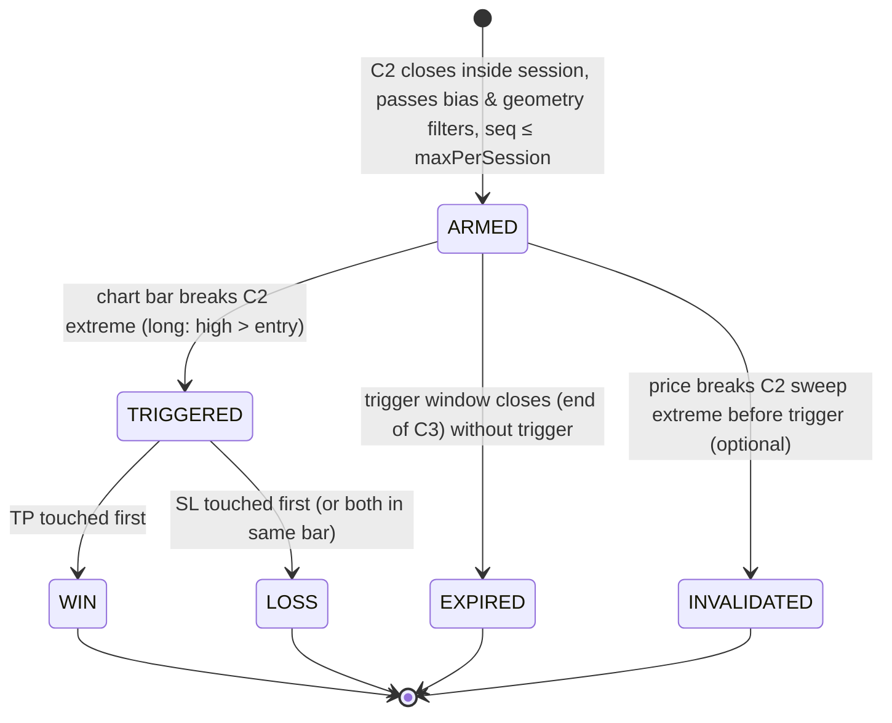

# CRT Nitro Indicator — Architecture Plan (Pine Script v6)

Status: PLAN ONLY. No code yet. Implementer: follow this document; deviations must be recorded in `DECISIONS.md`.

Source material: `vid_crt_one_perfect_trade_per_day.txt` (Nitro Trades, "CRT – one perfect trade per day"), two screenshots (concept slide + MNQ replay).

---

## 1. Strategy specification (ground truth distilled from the transcript)

### 1.1 Three-candle sequence on a CRT timeframe (15m / 30m / 1H)

| Candle | Role | Rule |
|---|---|---|
| C1 | Range candle | Mark `C1.high` and `C1.low` **including wicks** (transcript 1:53–2:05). |
| C2 | Sweep candle | Wick breaks **exactly one** side of C1 (`C2.high > C1.high` XOR `C2.low < C1.low`) and the **body close is back inside** the range: `C1.low < C2.close < C1.high` (2:07–2:28). |
| C3 | Delivery candle | Expected to make a "U-shaped" move to the **opposite** end of C1 (2:52–3:17). Entry is taken **while C3 is forming**, on a 1m/2m chart, when price breaks the C2 extreme on the non-swept side (3:33–4:03). |

Direction:
- **Bullish CRT**: C2 sweeps `C1.low`. Entry = `C2.high`. TP = `C1.high`.
- **Bearish CRT**: C2 sweeps `C1.high`. Entry = `C2.low`. TP = `C1.low`.

### 1.2 Risk model (5:33–6:12)
- TP is fixed at the opposite C1 extreme.
- SL is **derived** from TP and entry so that the trade is exactly `RR` (default 1.5, range 1.5–2):
  - Long: `reward = TP - entry`; `risk = reward / RR`; `SL = entry - risk`.
  - Short: `reward = entry - TP`; `risk = reward / RR`; `SL = entry + risk`.
- Trade is left alone until TP or SL (10:50–10:58). No management.

### 1.3 Filters (6:14–6:31, 7:50–8:55, 13:40–16:21)
- **Session**: look for setups from 09:30 ET; stop at 12:00–13:00 ET. (User trades 08:00–13:00 ET; session is an input.)
- **Trend / bias**: read the 1H chart. Uptrend = higher highs + higher lows → longs only. Downtrend = lower highs + lower lows → shorts only. Counter-trend CRTs are ignored.
- **Frequency**: "first CRT of the day with the trend" → user requirement: plot only the **first 2 setups per session per timeframe** (15m, 30m, 1H independently).

### 1.4 Ambiguities resolved (defaults; every one is an input)

| Topic | Decision | Rationale |
|---|---|---|
| C2 sweeps both sides and closes inside | **Reject** | Direction undefined; transcript only shows single-sided sweeps. |
| "Closes back inside" | Close strictly inside `(C1.low, C1.high)`; option `requireBodyInside` additionally requires `C2.open` inside | Transcript says "colored part of the candle closes back inside". |
| Entry window | Trigger valid only while C3 forms (`triggerWindowBars = 1` HTF candles). If C3 closes untriggered → `EXPIRED` | 10:26–10:29: "if it doesn't break the middle candle, absolutely nothing will be done". |
| Pre-trigger invalidation | If price trades through the C2 sweep extreme (long: `< C2.low`) before triggering → `INVALIDATED` | Sweep failed; the premise is gone. Input `invalidateOnSweepBreak`, default on. |
| Setup counting for "first 2" | Count when the setup becomes `ARMED` (C2 closes inside session and passes filters). Input `countMode = Armed \| Triggered` | User wants to *spot* setups; an armed setup consumes attention even if never triggered. |
| Session membership | C2 **close time** must fall inside the session window | 1H C2 that opened 09:00 and closed 10:00 is a valid first hourly candle after open. |
| Trend neutral (no clean HH/HL or LH/LL) | Allow both directions (`neutralMode = Both`); alt `None` | Avoid missing trades when structure is unclear; user can tighten. |
| Reward ≤ 0 (entry at/beyond TP) | Reject | Impossible geometry for a valid trade. |
| TP and SL both hit in the same chart bar | Resolve as **LOSS** (conservative) | Intrabar order unknown; conservative stats. Input `ambiguousOutcome`. |
| Fill price | Planned entry = C2 extreme; if the chart bar opens past it, record `fill = open` and show slippage in label; TP/SL stay as planned | Mirrors a stop order fill. |
| Minimum geometry | `minRewardTicks` (default 0 = off), `minStopTicks` (default 0 = off) → reject if violated | Protect against micro-range setups where 1.5R produces a 2-tick stop. |

---

## 2. Runtime model

### 2.1 Chart requirements
- Indicator runs on a **lower-timeframe chart**: 1m (recommended, per video), 2m, 3m, or 5m. Max 15m.
- Every enabled CRT timeframe must be an integer multiple of the chart timeframe. Violations → `runtime.error()` with a clear message.
- Symbol: any, tuned for CME equity index futures (ES/NQ/MES/MNQ). Uses `syminfo.mintick`, `syminfo.pointvalue` for tick/$ math.

### 2.2 HTF candle construction: local aggregation (no `request.security` for CRT candles)
Build 15m/30m/60m candles **on the chart timeframe** by detecting period boundaries with `time(tf)` and folding chart-bar OHLC into a running candle.

Why local aggregation instead of `request.security`:
- The entry trigger must be evaluated intrabar on the chart TF **during C3**; we already need chart-bar granularity, so the HTF bar is just a fold over chart bars.
- Zero repaint ambiguity: C1/C2 are finalized exactly on the chart bar where `time(tf)` changes.
- No `request.security` budget consumed (keeps room for trend filter + future additions); deterministic in replay/backtest and realtime.
- Risk: differs from TradingView HTF candles only if chart bars are missing (data gaps). Negligible on CME futures. Document in README.

Boundary rule: `newPeriod = ta.change(time(tf)) != 0`. On `newPeriod`, the running candle is **finalized** (becomes the newest completed candle), `C1 ← previous completed`, `C2 ← just completed`, then a fresh running candle starts from the current chart bar.

### 2.3 Trend/bias filter (uses `request.security`, 1 call)
Bias is computed on **1H** regardless of CRT timeframe (transcript: "look at the 1-hour chart").
- Mode `Auto (1H structure)` (default): pivots via `ta.pivothigh/ta.pivotlow(left, right)` on 1H (`pivotLen` default 3). Compare the last two confirmed swing highs and last two confirmed swing lows:
  - HH & HL → `BULL`; LH & LL → `BEAR`; else `NEUTRAL`.
  - Fetched non-repainting: `request.security(syminfo.tickerid, "60", expr[1], lookahead = barmerge.lookahead_on)` or equivalent confirmed-bar pattern. Pivot confirmation already lags `right` bars; acceptable.
- Mode `EMA (1H)`: `close > ema(len)` on 1H → BULL, else BEAR. Simpler alternative.
- Mode `Manual`: `Long only | Short only | Both`. Lets the user override on days where they judged the shift by eye (14:00–14:40).
- Bias is sampled **at the moment a setup is armed** and stored on the setup; later bias changes do not retroactively remove drawn setups.

### 2.4 Session
- `session` input, default `0930-1300`, timezone input default `America/New_York`.
- `inSession = not na(time(timeframe.period, session, tz))`.
- Session day key: `dayofmonth/month/year` in the session timezone → resets per-TF counters when it changes.
- Optional `showPreSessionCandles` to draw C1 ranges before open for context (default off).

---

## 3. Module layout

Pine cannot split one indicator across files without publishing a library. Plan: **one file, strictly sectioned**, with pure functions and user-defined types so that extraction into a library (`CRTLib`) is mechanical later. Section order is mandatory (Pine requires declaration before use).

```
crt_nitro.pine
├── 0. Header            // @version=6, indicator(..., overlay=true, max_lines_count=500, max_labels_count=500, max_boxes_count=500)
├── 1. Constants & enums // enum Dir, enum State, enum BiasMode, enum CountMode, tf strings
├── 2. Inputs            // grouped, see §4
├── 3. Types             // Candle, Setup, TfContext, Theme
├── 4. Pure helpers      // math/geometry: tick rounding, RR → SL, ticks→$, contracts for $ risk
├── 5. Session module    // inSession, sessionDayKey, newSessionDay
├── 6. Bias module       // 1H structure/EMA/manual → Dir|NEUTRAL
├── 7. Aggregator module // fold chart bars into HTF candle per TfContext
├── 8. Detector module   // detectCRT(c1, c2) → (dir, reason) ; applies geometry filters
├── 9. Lifecycle module  // step(setup, bar) state machine: ARMED→TRIGGERED→WIN/LOSS | EXPIRED | INVALIDATED
├── 10. Renderer module  // create/update/finalize drawings for a Setup; theme per TF
├── 11. Alerts module    // alert() messages, alertcondition() hooks
├── 12. Dashboard module // table: bias, session, per-TF counters & live state, debug reasons
└── 13. Main loop        // per bar: session → bias → for each enabled TF: aggregate → detect → lifecycle → render → alerts → dashboard
```

### 3.1 Types

```pine
type Candle
    float o
    float h
    float l
    float c
    int   tOpen      // period open time (ms)
    int   barIdxOpen // chart bar_index where the period started
    int   barIdxClose

type Setup
    string tf            // "15" | "30" | "60"
    Dir    dir           // LONG | SHORT
    State  state         // ARMED | TRIGGERED | WIN | LOSS | EXPIRED | INVALIDATED
    int    seq           // 1 or 2 within the session for this tf
    Candle c1
    Candle c2
    float  entry         // planned (C2 extreme)
    float  fill          // actual (na until triggered)
    float  tp
    float  sl
    float  rr
    Dir    biasAtArm
    int    armedBar
    int    triggerBar
    int    resolveBar
    int    expiryBar     // chart bar_index at which C3 (or trigger window) closes
    // drawings
    line   lnEntry
    line   lnTp
    line   lnSl
    box    bxReward
    box    bxRisk
    box    bxC1Range
    label  lbl

type TfContext
    string tf
    bool   enabled
    Candle running       // forming HTF candle
    Candle prev1         // most recent completed (becomes C2 on detection)
    Candle prev2         // one before (becomes C1)
    int    armedCount    // per session day
    array<Setup> active  // setups not yet terminal (usually 0–2)
    array<Setup> history // terminal setups kept for drawings/stats (bounded by maxHistoryPerTf)
```

### 3.2 Module contracts

| Module | Signature (conceptual) | Pure? | Notes |
|---|---|---|---|
| Aggregator | `aggregate(ctx) → bool periodClosed` | mutates `ctx.running/prev1/prev2` | Must be called every bar before detection. |
| Detector | `detect(c1, c2, bias, filters) → (Dir dir, string rejectReason)` | yes | `dir = NONE` when rejected; reason strings feed the debug table ("both sides swept", "closed outside", "counter-trend", "reward ≤ 0", "stop < min", ...). |
| Geometry | `levels(dir, c1, c2, rr) → (entry, tp, sl)` | yes | Round SL to `syminfo.mintick`; ensure SL is at least 1 tick from entry. |
| Lifecycle | `step(setup, barH, barL, barO, barIdx) → State` | mutates setup | Transitions monotonic; evaluated every tick; same-bar TP/SL ambiguity → `ambiguousOutcome`. |
| Renderer | `draw(setup)`, `update(setup)`, `finalize(setup)` | mutates drawings | Idempotent per state; extends right edge each bar while non-terminal. |
| Alerts | `emit(setup, prevState)` | side effects | `alert()` with `alert.freq_once_per_bar`; message is JSON-ish for webhook use. |

### 3.3 Lifecycle state machine



Trigger/resolution use chart-bar `high/low` touches (`>=` / `<=`). On the trigger bar itself, also evaluate TP/SL on the same bar after the fill (use remaining range conservatively: if the bar's low ≤ SL on a long trigger bar → treat as ambiguous → `ambiguousOutcome`).

Expiry bar: `expiryBar = c2.barIdxClose + barsPerPeriod(tf) * triggerWindowBars` where `barsPerPeriod = tfMinutes / chartMinutes`. Simpler and gap-safe alternative: expire when the aggregator reports `periodClosed` `triggerWindowBars` times after arming. Use the aggregator-count approach.

### 3.4 Per-bar main loop (order matters)

1. Compute `inSession`, `sessionDayKey`; if day changed → reset `armedCount` for every TF, optionally purge drawings older than `keepDays`.
2. Compute `bias` (security call executes unconditionally — Pine requires `request.*` outside conditionals).
3. For each `TfContext` (15, 30, 60), in that order:
   1. `step` every active setup with the current chart bar (trigger/TP/SL/invalidate). Do this **before** aggregation so the current bar cannot both close C2 and trigger the entry (entry must occur in C3).
   2. `aggregate(ctx)`; if `periodClosed`:
      - Increment each active setup's period counter; expire if window exhausted.
      - If `inSession` (checked at the C2 close bar) and `armedCount < maxPerSession`: `detect(prev2, prev1, bias)`; on success build `Setup`, `seq = armedCount + 1`, push to `active`, `armedCount++`, `draw`, alert.
      - Else if debug: record reject reason for the dashboard.
   3. Move terminal setups from `active` → `history`; `finalize` drawings; trim `history` to `maxHistoryPerTf` (delete drawings of trimmed items).
4. Render dashboard table (only on `barstate.islast` to save resources).

---

## 4. Inputs (grouped)

| Group | Input | Type / Default | Notes |
|---|---|---|---|
| Session | `session` | session, `0930-1300` | User may set `0800-1300`. |
| Session | `tz` | string, `America/New_York` | |
| Session | `maxPerSession` | int, `2` (1–5) | "first 2 of the session" per TF. |
| Session | `countMode` | enum `Armed`/`Triggered`, `Armed` | |
| Timeframes | `use15`, `use30`, `use60` | bool, all `true` | |
| Timeframes | `triggerWindowBars` | int, `1` (1–3) | HTF candles after C2 in which the trigger is valid. |
| Trade | `rr` | float, `1.5` (1.0–3.0, step 0.1) | |
| Trade | `minRewardTicks`, `minStopTicks` | int, `0` | 0 = off. |
| Trade | `invalidateOnSweepBreak` | bool, `true` | |
| Trade | `ambiguousOutcome` | enum `Loss`/`Win`/`Unknown`, `Loss` | |
| Trade | `requireBodyInside` | bool, `false` | Also require `C2.open` inside C1. |
| Bias | `biasMode` | enum `Auto 1H structure`/`EMA 1H`/`Manual`, `Auto` | |
| Bias | `pivotLen` | int, `3` | For Auto. |
| Bias | `emaLen` | int, `50` | For EMA. |
| Bias | `manualBias` | enum `Long`/`Short`/`Both`, `Both` | For Manual. |
| Bias | `neutralMode` | enum `Both`/`None`, `Both` | When Auto yields NEUTRAL. |
| Bias | `showCounterTrend` | bool, `false` | Draw rejected counter-trend setups faded, not counted. |
| Sizing | `riskUsd` | float, `0` | 0 = hide; else label shows contracts = floor(riskUsd / (stopTicks × tickValue)). |
| Visuals | `color15/30/60` | colors | Distinct hue per TF (e.g. 15m blue, 30m orange, 1H purple). |
| Visuals | `showC1Range` | bool, `true` | Faint box over C1 range from C1 open to resolution. |
| Visuals | `showRiskBoxes` | bool, `true` | Green reward box, red risk box from trigger bar. |
| Visuals | `extendUntilResolved` | bool, `true` | |
| Visuals | `keepDays` | int, `5` | Drawings older than this are deleted. |
| Visuals | `showDashboard`, `dashPos` | bool `true`, position | |
| Visuals | `debug` | bool, `false` | Reject reasons in dashboard + `label.new` markers at rejected C2 closes. |
| Alerts | `alertOnArm`, `alertOnTrigger`, `alertOnResolve` | bool, all `true` | |

---

## 5. Rendering spec

Per setup, at `ARMED`:
- Entry line (solid, TF color) from `c2.barIdxClose` → right edge (extends each bar while non-terminal).
- TP line (green, solid) and SL line (red, dashed) same span.
- Optional C1 range box (TF color, ~90% transparency) spanning `c1.barIdxOpen` → right edge.
- Label at the entry line, right-anchored, text:
  `1H ▲ CRT #1 · E 5520.25 · TP 5531.50 (+45t) · SL 5512.75 (−30t) · 1.5R · 3ct`
  (`▲`/`▼` direction, `#seq`, ticks via `syminfo.mintick`, contracts only when `riskUsd > 0`).
- Small triangle marker under/over the C2 sweep wick on the chart (`label.style_triangleup/down`, tiny) — quick visual of "where the sweep happened".

At `TRIGGERED`: reward/risk boxes from `triggerBar` to right edge; label appends `· FILLED @ price (+slip t)`.

Terminal states: stop extending at `resolveBar`; label appends `✔ TP` / `✘ SL` / `⌛ EXP` / `⊘ INV`; lines go dotted and 50% transparent. Counter-trend ghosts (if enabled): gray, dotted, no label text beyond `✕ counter-trend`.

Drawing budget: ≤ 3 lines + 3 boxes + 2 labels per setup; `maxHistoryPerTf = 20` → worst case 3 TFs × 22 setups × 8 objects ≈ 530 → set `maxHistoryPerTf` default `15` to stay under 500 per type with margin, and always `line.delete`/`box.delete`/`label.delete` on trim.

Dashboard table (top-right default), rows: `Bias 1H: BULL/BEAR/NEUTRAL (mode)`, `Session: OPEN/CLOSED (hh:mm left)`, then one row per TF: `15m · armed 1/2 · state: ARMED (E 5520.25) · last: WIN`. Debug mode appends last reject reason per TF.

---

## 6. Alerts

Use `alert(message, alert.freq_once_per_bar)` with messages:
- Arm: `CRT ARMED | {sym} | {tf} | {LONG/SHORT} | #{seq} | entry={e} tp={tp} sl={sl} rr={rr}`
- Trigger: `CRT TRIGGERED | ... | fill={fill}`
- Resolve: `CRT {WIN|LOSS|EXPIRED|INVALIDATED} | ...`

Also expose `alertcondition()` for `anyArmed`, `anyTriggered` so the user can create static alerts without "any alert() function call".

---

## 7. Edge cases checklist (implementer must handle)

1. First bars of history: `prev1/prev2` are `na` → skip detection until two completed HTF candles exist.
2. Session day rollover inside a running HTF candle (not possible for 09:30–13:00, but code must not assume).
3. Chart gaps / holidays: aggregator keyed on `time(tf)` change, never on bar counting.
4. Two active setups on the same TF simultaneously (seq 1 armed and untriggered when seq 2 arms): allowed; both tracked.
5. Setup on 15m and 1H sharing the same C1/C2 candles → independent objects, independent counters (user asked for all three TFs).
6. Realtime tick rollback: all mutations are recomputed per tick from the bar's current OHLC; state is monotonic; drawings created in the realtime bar are rolled back by Pine automatically. Don't rely on `barstate.isconfirmed` for triggers (latency), but alerts use `freq_once_per_bar`.
7. `request.security` must be called at top level every bar (not inside `if`).
8. SL rounding: round **away** from entry to the tick grid so realised RR ≥ configured RR.
9. Entry exactly equal to TP after rounding → reject (reward ≤ 0).
10. User puts indicator on a 15m chart: 15m CRT entries become same-bar; warn in dashboard ("chart TF too coarse for 15m triggers").

---

## 8. Validation plan (no unit tests exist in Pine; use replay + script-level asserts)

1. **Known examples from the video** (MNQ, 2026-05-05 and following day; MES bearish example ~day of upload). In bar replay on 1m: confirm a bullish 1H/15m CRT arms after the first sweep candle, entry at C2 high, TP at C1 high, SL at 1.5R, and resolves WIN.
2. **Synthetic checks** via `debug` mode: scroll through a week of ES 1m; every C2 close during session either arms or shows a reject reason; no silent skips.
3. **Geometry assert**: in debug mode, on arm compute `(tp-entry)/(entry-sl)` and `runtime.error` if `< rr - 0.01` (catches rounding bugs). Remove or gate behind `debug` before release.
4. **Counting**: verify no TF ever draws a 3rd setup in a session; verify counters reset next day.
5. **Performance**: script must load on 1m chart with 20k bars without timeout; measure with all three TFs + debug off.
6. **Realtime**: run live 09:30–10:30 ET one morning; confirm alerts fire once and drawings do not duplicate.

---

## 9. Deliverables for the implementer

- `crt_nitro.pine` — the indicator, sections as in §3.
- `README.md` — setup (chart TF, inputs), what each line/label means, known limitations (local aggregation vs HTF candles, intrabar ambiguity, pivot lag on bias).
- `DECISIONS.md` — any deviation from this plan with rationale.
- Optional later: extract §3 modules 4, 6, 8, 9 into a published library `CRTLib` once stable.

---

## 10. Out of scope (explicitly)

- Order execution / broker integration (indicator, not strategy). A `strategy()` variant can be derived later from the same Lifecycle module.
- Multi-symbol scanning.
- Trade management (BE moves, partials) — contradicts the strategy as taught.
