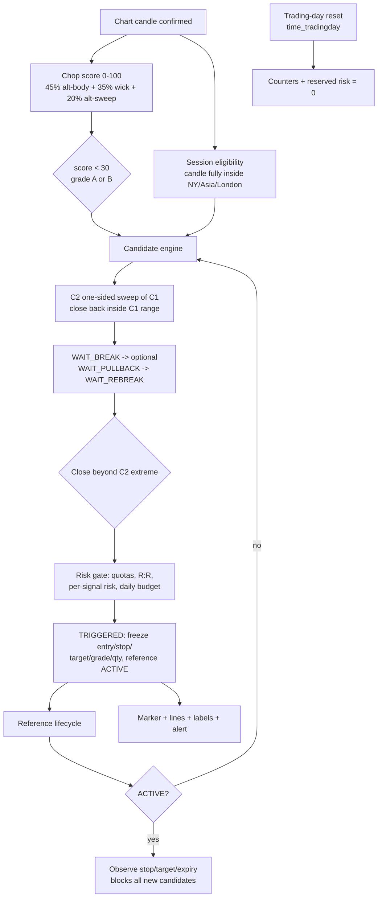

# CRT Nitro Indicator — Completion Plan (Handoff)

Authored: 2026-10-13. Target reader: the agent that resumes this build.
Source of truth for current code: `crt-nitro-indicator.pine` (1262 lines, `//@version=6`, header version `0.5.0-alpha.1`).

**No code changes were made while producing this document.** All line references below are against the current `crt-nitro-indicator.pine` as of this writing. Re-read before editing; line numbers shift after the first patch.

---

## 1. Where the build stopped

### 1.1 Delivered increments (per `new-crt-nitro-indicator-session.md`)

| Version | Scope | User-reported status |
| --- | --- | --- |
| 0.1.0 / 0.1.1-alpha.1 | Closed-candle chop score, sampled history, Improving/Worsening/Constant, supported-TF guard, current-TF-only dashboard | Compiles; partially verified |
| 0.2.0-alpha.1 | Native-TF C1/C2 detection, Direct vs Re-break sequencing, C3-only expiration, session filter, structural invalidation, diagnostic markers | Compiles; partially verified |
| 0.3.0 / 0.3.1-alpha.1 | Separate daily long/short counters, frozen plan levels + grade, entry/stop/target drawings, long/short alerts | Compiles; partially verified |
| 0.4.0-alpha.1 | Micro-equivalent sizing, max risk/signal, daily reserved-risk budget, max contracts, min gross R:R, cost allowance, combined daily cap | Compiles; partially verified |
| 0.5.0-alpha.1 | Single-active-reference lifecycle, post-entry target/stop/ambiguous observation, candle + session + day expiry, no risk refund | **Compiles; verification pending** |

### 1.2 The actual stopping point

The session transcript ends with:

> "last response didn't come through because I ran out of usage credits"

So **0.5.0-alpha.1 is the last complete artifact.** No 0.6.0 content exists in any file. The roadmap items the prior agent explicitly deferred and never delivered:

1. **The separate 1H bias filter from the original indicator was never restored** (stated as "not included" in the 0.2.0 notes and never revisited).
2. **No lifecycle alerts** — only entry alerts exist (`crt-nitro-indicator.pine:954-981`).
3. **No outcome accounting** — the lifecycle records only the *single latest* reference's end state; there is no tally of target/stop/ambiguous/expired, and no simulated P&L.
4. **No account-level risk governance** — the $450 "reserved signal-risk budget" is a pre-trade reservation heuristic, not a daily-loss lockout, trailing-drawdown floor, or profit-target tracker. Requirement #12 (50k eval, PT 3k, DD 2k, EOD, DLL) is therefore unimplemented.
5. **Verification file is incomplete** — `crt-nitro-indicator-verification-tests.md` stops mid-sentence at item 10 of the 0.5.0 list and contains no pass/fail marks.

### 1.3 Architecture as it stands

Logic-ordering invariants already correct and worth preserving:
- Chop state commits on confirmed bars only (`:413`), so the dashboard does not flicker intrabar.
- Stop is checked **with** target on the same candle and reported `AMBIGUOUS` rather than a win (`:580-582`) — this fixes the old indicator's "TP checked before SL" defect.
- Price observation starts **after** the entry candle (`:548-549`, `bar_index > crtLastPlanBar`).
- Stop is structural (C2 opposite extreme ± buffer, `:772-774`); R:R is validated against it rather than the stop being solved backward from a target R:R.
- `targetConsumed` and `invalidated` are evaluated **before** the trigger test (`:654-659`), so a candle that already hit the target cannot also be admitted as an entry.

---

## 2. Defect register

Severity: **S1** = wrong or missing signals; **S2** = functional but unusable defaults / misleading display; **S3** = hygiene.

### D-01 (S1) A candle that resolves a pending candidate cannot arm a new one

`:627` sets `handledThisBar := true` for any pending candidate; `:765` requires `not handledThisBar` to arm. Consequence: the candle on which a setup EXPIRES / is CANCELLED / INVALIDATED / TARGET_CONSUMED is discarded as a C2 candidate even when it is a textbook one-sided sweep. With the default `crtMaxBars = 1`, every failed setup burns the next candle. This is the same class of defect as `old-crt-indicator-issues.md` row 2 ("consecutive valid C2 candles can be missed"), reintroduced in a different form.

**Required fix:** after a pending candidate reaches a terminal non-TRIGGERED state, fall through to candidate arming on the same candle. `TRIGGERED` must continue to block (single-reference rule), and the "reference ended this candle" lock (`crtPlanEndedThisBar`) is a separate, deliberate rule — keep it unless D-02 changes it.

### D-02 (S1) Daily quotas are unreachable; on 60m the engine is near-dead

`crtPlanState == "ACTIVE"` blocks all new candidates (`:766`). Defaults: `crtPlanMaxBars = 12`, `crtEndPlanWithSession = true`, NY AM only, `0930-1200`. Session eligibility requires the candle to be **fully** inside the session (`:261`).

Derived candle budgets per day with default settings:

| Chart TF | Candles fully inside 0930–1200 | Max arm→trigger pairs | Signals/day reachable |
| --- | --- | --- | --- |
| 15m | 10 | ~4 before the lifecycle lock | 1 |
| 30m | 5 | ~2 | 1 |
| 60m | 2 (1000–1100, 1100–1200) | 1 | 1, and only if C2 is the 1000–1100 candle |

A triggered reference holds `ACTIVE` until the session ends, so the configured `2 LONG + 2 SHORT + 3 combined` caps can never bind. On 60m the engine has exactly one opportunity per day and Re-break mode (needs `crtMaxBars >= 3`, `:782`) can never complete inside the session.

**Required fix, three parts:**
1. Add a session-boundary mode input: `Strict (candle fully inside)` / `Snap to chart candles` (default **Snap**). Snap rounds the session start down and the session end up to chart-TF boundaries so a 0930 start is usable on a 60m chart.
2. Add `Maximum concurrent references` (int, 1–4, default **2**) and track references per direction, or minimally: allow a new candidate while a reference is active **in the opposite direction**. The 2-long/2-short requirement implies at least directional concurrency.
3. Re-default the session windows per chart TF, or ship a wider default (`0930-1600` for RTH) with NY AM as an opt-in sub-window. State the chosen default in the dashboard.

If concurrency is widened, the frozen-plan storage (`crtLastPlan*`, `:469-487`) must become arrays or per-direction pairs, and the 3 line/3 label singletons (`:865-870`) must become per-reference collections. `max_lines_count`/`max_labels_count` (`:14`) must be raised accordingly.

### D-03 (S2) "Auto (chop-based)" mode is a silent dead end on default settings

`:776-778` selects Re-break whenever `closedScore >= 15`. `:782` rejects Re-break when `crtMaxBars < 3`. Default `crtMaxBars = 1`. So in Auto mode every grade-B setup is armed and instantly `REJECTED`, and only grade-A setups can ever proceed. Fix: when Auto selects Re-break and `crtMaxBars < 3`, either fall back to Direct or surface a persistent dashboard warning cell; do not silently reject. Recommend: raise `crtMaxBars` default to 3 and make the Auto threshold an input.

### D-04 (S2) Rejected candidates overwrite the candidate dashboard block

`:784-793` writes `crtDirection`, `crtBornBar`, `crtBornTime`, `crtBreakLevel`, `crtTargetReference`, `crtStopReference`, `crtMode` **before** the validity branch at `:800-822`. A candidate rejected for DAILY_CAP / RISK_BLOCKED / REJECTED still repaints rows 5–9 of the dashboard with its levels. Frozen *plan* drawings are unaffected (separate variables), which is correct. Fix: compute into locals, commit to state only on `WAIT_BREAK`, and show rejected candidates in a dedicated "last rejected" row if that information is wanted.

### D-05 (S2) `chopQualified` duplicates the grade thresholds

`:435` hardcodes `closedScore < 30`; `f_grade` (`:166-171`) and `f_gradeColor` (`:173-179`) hardcode the same boundaries again. Three copies of the A/B/C/D/F cut points. Fix: single `CHOP_A`/`CHOP_B`/`CHOP_C`/`CHOP_D` constants, derive all three. Also expose "Minimum chop grade for entry" as an input (`A` / `B`), defaulting to `B`, so the gate is visible rather than implied.

### D-06 (S2) Session string parsing is positional and ignores the day mask

`f_crtSessionKey` (`:240-261`) assumes exactly `HHMM-HHMM` and reads fixed offsets 0,2,5,7. If the user edits an `input.session` to include a day-of-week mask (`0930-1200:23456`) the mask is silently dropped and the session applies every day. Also `timestamp(zone, yy, mm, dd - 1, ...)` at `:258` relies on Pine normalizing day `0` at month boundaries — verify, or clamp explicitly. Fix: validate the string length/format, parse and honour the `:` day mask, and show `Invalid session string` in the dashboard instead of producing garbage keys.

### D-07 (S3) Score normalization is off by one candle for two of three components

`alternatingCount` and the sweep loop run `0 to lookback - 2` (`:355`) — max `lookback - 1` events — but both are divided by `lookback` (`:394`) / `lookback * 0.5` (`:397`). `wickCount` runs the full `lookback` (`:384`). So the alternating component saturates at 95, not 100, and the weighted score cannot reach 100. Harmless to grading today but it makes the thresholds slightly non-comparable across `lookback` values. Fix the denominators to the actual sample counts.

### D-08 (S3) Dead and write-only state

- `crtLastPlanEndBar` (`:485`, `:514`, `:538`, `:595`, `:759`) is assigned five times and never read. Either surface it or delete it.
- The `planAge > crtPlanMaxBars` branch (`:568`) is unreachable in normal operation because `planAge >= crtPlanMaxBars` (`:589`) ends the reference one candle earlier; it only fires if the input is lowered mid-life. Keep as a guard but comment it as such.
- `// END OF PART 1 OF 3` / `PART 2 OF 3` / `PART 3 OF 3` markers (`:311-313`, `:824-826`, `:1261`) are artifacts of chat-window chunking. Now that the script is a file, delete them and use plain section banners.

### D-09 (S3) Trading-day label timezone mismatch

`:1164-1166` formats `crtCountDay` in `"UTC"` while every other timestamp uses the `logTimezone` input. For CME instruments the trading day starts 18:00 ET the prior calendar day, so the UTC-rendered date can look "wrong" next to the ET-rendered candle times. Decide one convention and annotate the cell.

### D-10 (S3) Duplicate documentation file

`old-crt-indicator-issues.md` and `old-crt-nitro-indicator-issues.md` are byte-identical. Delete one.

### Non-defects — deliberate design, do not "fix" without asking

- Entry requires a **close** beyond C2's extreme, not a wick touch.
- A candle sweeping both sides of C1 is rejected (`crtOneSidedC2`, `:618`).
- Reserved risk is never refunded when a reference ends (`:598`).
- `TARGET_CONSUMED` rejects a setup whose target was tagged before entry confirmation — restrictive by intent.
- Both-levels-reached is `AMBIGUOUS`, never a win.

---

## 3. Open decisions (answer before Phase 2)

These are listed with the default the resuming agent should adopt if no answer arrives, so the build never blocks.

| # | Decision | Default to adopt if unanswered |
| --- | --- | --- |
| Q1 | The stated trading purpose is 15m/30m/60m, but the code and the guard text both support 5m ("Use a 5m, 15m, 30m or 60m timeframe", `:152-154`, `:1020`). Should 5m be tradable? | **5m = chop diagnostics only.** CRT engine disabled on 5m with a dashboard note; guard text keeps all four as *supported charts*. |
| Q2 | How many references may be open at once? | **2 max, one per direction.** Same-direction re-entry only after the prior same-direction reference ends. |
| Q3 | The 0.3.0 notes cite a "$300 daily loss limit"; 0.4.0 shipped a $450 reserved-risk budget. Which governs? | **DLL = $300** becomes the hard lockout; reserved-risk budget default drops to $300 and is clamped to never exceed the DLL. |
| Q4 | What defines the 1H bias filter in the original indicator? (The old script is not in this repo — only its issue list.) | **Bias = sign of the last *confirmed* 1H candle body** (`close - open`), requested with `lookahead_off` and `[1]`. Require sweep-direction alignment. Ship the filter **OFF by default** until the user validates it in replay. |
| Q5 | Should the outcome ledger simulate P&L? | **Yes, reference-only:** frozen qty × points × point value, minus `crtCostAllowance × qty` per side-pair, tallied per trading day. Label every cell "reference, not fills". |
| Q6 | EOD vs intraday trailing drawdown for the 50k eval? | **EOD**, per requirement #12. Track peak *reference* equity at trading-day close only. |
| Q7 | Is the full-size chart with micro sizing still wanted (ES chart → MES risk)? | **Yes**, keep `Micro equivalent` as the default `crtSizingMode`. |

---

## 4. Phased work plan

Each phase: one version bump, one coherent feature set, header comment + `indicator()` title + dashboard version cell + alert strings all updated together. **Patch-level bumps for fixes that add no feature set** (per requirement #10).

### Phase 1 — `0.5.1-alpha.1` — Signal integrity and throughput

Fixes only. No new feature surface.

- D-01: same-candle re-arm after a non-TRIGGERED terminal state.
- D-02 part 1: session-boundary mode input (`Strict` / `Snap to chart candles`, default Snap) applied in `f_crtSessionKey`.
- D-02 part 3: re-default session windows so each supported TF has ≥6 eligible candles in the primary session.
- D-03: `crtMaxBars` default → 3; Auto-mode threshold as input; Auto falls back to Direct when the window is too short, with a dashboard reason cell.
- D-04: candidate state committed only on `WAIT_BREAK`.
- D-05: single source of truth for chop thresholds + "Minimum chop grade" input.
- D-06: session-string validation and day-mask support.
- D-07: score denominators.
- D-08: delete `crtLastPlanEndBar`, comment the guard branch, delete PART-OF-3 markers.
- D-09: trading-day label convention.
- D-10: delete the duplicate issues file.

**Acceptance:** compiles in the TradingView editor; on 15m NQ in replay, a failed setup followed immediately by a valid one-sided sweep arms on that same candle; on 60m the dashboard shows ≥6 eligible session candles; Auto mode never produces an instant `REJECTED` on default settings.

### Phase 2 — `0.6.0-alpha.1` — Directional concurrency and reachable quotas

D-02 part 2. This is the structural change, so it gets its own version.

- `Maximum concurrent references` input; per-direction reference slots.
- Convert `crtLastPlan*` singletons into a reference record set (two slots under the Q2 default; use `array<...>` or two explicit structs so the shape survives a later bump to 4).
- Per-reference lines/labels; raise `max_lines_count` / `max_labels_count` to cover `4 × 3` plus headroom.
- Dashboard: one row per live reference, showing direction, grade, age/limit, status.
- Reconcile `crtPlanEndedThisBar`: the lock must apply per direction, not globally.

**Acceptance:** in replay, a long reference and a short reference can be simultaneously active; `2 LONG / 2 SHORT / 3 combined` caps are demonstrably reachable and demonstrably binding on the 4th signal; all 9 rows of the 0.3.0 verification table still pass.

### Phase 3 — `0.7.0-alpha.1` — 1H bias filter

Restores the deferred item. Per Q4.

- `request.security(syminfo.tickerid, "60", <expr>, lookahead = barmerge.lookahead_off)` with a `[1]` confirmed-bar offset — this is the explicit fix for `old-crt-indicator-issues.md` row 1. Never read a developing HTF value.
- On a 60m chart the filter must degrade to the chart's own prior confirmed candle, not request its own TF redundantly.
- Inputs: `Enable 1H bias filter` (default **off**), `Bias source`, `Require alignment / Block counter-bias only`.
- Dashboard: 1H bias direction, bias candle close time, and whether the filter is currently blocking.
- Raise `max_bars_back` if the HTF series needs more history than 200.

**Acceptance:** with the filter on, a long candidate during a confirmed-down 1H candle is rejected with a `BIAS_BLOCKED` state and no counter increment; the displayed bias does not change intrabar; on a 60m chart the filter is consistent with the visible prior candle.

### Phase 4 — `0.8.0-alpha.1` — Outcome ledger and lifecycle alerts

- Per-trading-day and session-to-date tallies: `TARGET_REACHED`, `STOP_REACHED`, `AMBIGUOUS`, `EXPIRED`, `SESSION_ENDED`, `DAY_ENDED`.
- Simulated reference P&L per Q5. Gross and net (after `crtCostAllowance`). Ambiguous outcomes counted as **losses** for accounting, and shown separately so the pessimism is visible.
- `alert()` on each lifecycle terminal event, with the reference's frozen levels, direction, grade, and the resulting day tally.
- Separate `alertcondition`s for target-reached and stop-reached.
- Data-window plots for every tally so TradingView's replay step-through is inspectable without the table.
- Cumulative (all-loaded-history) tallies in addition to per-day, clearly labelled as history-dependent.

**Acceptance:** stepping replay through one full session reproduces, by hand, every tally value shown; a stop-reached event fires exactly one alert on the confirming candle close; ambiguous candles appear in the ambiguous bucket and nowhere else.

### Phase 5 — `0.9.0-alpha.1` — Prop-eval risk governor

Requirement #12. 50k size, PT $3k, DD $2k, EOD drawdown, daily loss limit, no monthly fee.

- Inputs: `Account size`, `Profit target`, `Max drawdown`, `Drawdown type (EOD / intraday)`, `Daily loss limit`, `Account floor mode`.
- Reference-equity ledger from Phase 4, seeded at account size.
- **Daily loss lockout:** when day-to-date reference P&L ≤ −DLL, block all new candidates for the remainder of the trading day; existing references keep being monitored. This takes precedence over directional quotas (explicitly required by the session notes).
- **EOD trailing floor:** floor = max(peak EOD reference equity − DD, account size − DD). Block new candidates when projected worst-case (current equity − next signal's reserved risk) would breach the floor.
- **Profit-target progress:** percentage-to-PT cell; optional `Stop arming new sequences once PT is reached`.
- Reconcile with the existing reserved-risk budget: budget becomes `min(remaining DLL headroom, remaining floor headroom, crtDailyBudget)`.
- Every cell in this block must carry a "reference accounting; not broker P&L" qualifier. The existing disclaimers at `:1159-1169` are the pattern to follow.

**Acceptance:** a scripted replay day whose references lose more than the DLL shows `DLL_LOCKOUT` and arms nothing further that day; the lockout survives a new session boundary within the same trading day; the floor calculation blocks a signal whose reserved risk would breach it even when a directional quota remains.

### Phase 6 — `0.9.1-beta.1` → `1.0.0` — Verification sweep, docs, stabilization

- Rewrite `crt-nitro-indicator-verification-tests.md` as a single living checklist with a status column (`PASS` / `FAIL` / `PENDING` / `N/A`) and the replay date for each, superseding the per-version append-only format. Fold in the new Phase 1–5 criteria. Fix the `0.5.0` list, which is truncated at item 10 and contains a typo ("confired").
- Add `CHANGELOG.md` keyed to the semantic versions already used.
- Add `README.md`: purpose, supported charts and instruments, input reference, what the indicator does **not** claim (no fills, no realized P&L, no validated edge), and the replay-verification procedure.
- Code hygiene pass: section banners, consistent `crt` prefixing, no magic numbers left.
- **`1.0.0` is user-gated.** Promote only when the user marks the checklist complete, per their instruction that the script not be marked stable until verification finishes. Drop the `UNSTABLE` dashboard cell at that point and only then.

---

## 5. Verification protocol for the resuming agent

There is **no local Pine compiler or runtime in this repo**, and none is available. Every "it compiles" and "it behaves" claim must come from the user pasting into the TradingView editor and stepping replay. The agent must therefore:

1. **Never claim compilation or behavioral success.** Report "ready for TradingView compile check" and list exactly what to look at.
2. After each phase, emit a short, explicit replay recipe: instrument, chart TF, date, session, settings deltas, and the expected dashboard/marker/alert outcome at named candles.
3. Prefer `display = display.data_window` plots for every new state variable (the script already does this at `:837-857`). This is the only practical step-through debugger for Pine and it is how the user verifies claims.
4. Self-review before handing off: indentation-only blocks, no `var` declared inside a conditional that was meant to be global, no reads of a developing HTF value, no intrabar mutation of persistent state outside `barstate.isconfirmed`.

### Replay recipes to prepare (one per phase, minimum)

| Phase | Scenario to construct in replay |
| --- | --- |
| 1 | Two consecutive one-sided sweeps where the first fails — both must be seen |
| 1 | 60m chart, NY session — count eligible candles in the dashboard |
| 2 | Long reference active while a short sweep forms — both must arm |
| 2 | Fourth signal of the day under a 3-combined cap — must be `DAILY_CAP` |
| 3 | Long candidate under a confirmed-down 1H candle — must be `BIAS_BLOCKED` |
| 4 | A candle whose range contains both stop and target — must be `AMBIGUOUS`, counted as a loss, one alert |
| 5 | Day whose reference P&L breaches the DLL — lockout for the rest of the trading day |

---

## 6. Hard constraints the resuming agent must respect

1. **Pine Script v6 only.** Keep `//@version=6` on line 2 with no leading blank-line drift.
2. **Never use `text`, `label`, `line`, `table`, `color`, `size`, or `style` as a parameter or variable name.** The session notes record a "text identifier fix" that must be retained — this is why `f_cell` takes `cellText` and `f_crtUpdateLabel` takes `labelText` (`:205`, `:292`). Breaking this reintroduces a compile error.
3. **All persistent state mutates only under `barstate.isconfirmed`.** No repainting. The dashboard and drawings may render on `barstate.islast` from already-committed state, which is the existing pattern.
4. **No HTF value read without a confirmed-bar offset.** `old-crt-indicator-issues.md` row 1.
5. **Indicator, not strategy.** Do not convert to `strategy()`. No `strategy.entry`, no broker integration, no order placement.
6. **No performance, win-rate, or edge claims** anywhere in code comments, labels, alerts, or docs. Chop grades are heuristics inherited from the user's original script.
7. **Semantic versioning, pre-release until the user says otherwise.** Version appears in: the header comment (`:3`), the `indicator()` title (`:12`), the dashboard cells (`:1014-1015`), and every alert string (`:959`, `:978`, `:981`). Update all of them in the same edit or they will drift.
8. **Edit `crt-nitro-indicator.pine` in place.** The three-part chat chunking is obsolete; the user copies the file. Do not re-introduce split deliverables.
9. **One phase per handoff.** The user hit response-length halts previously and asked for manageable chunks. Finish and report a phase before starting the next.
10. **Instrument scope:** ES/MES, NQ/MNQ, YM/MYM, RTY/M2K, USD futures. Micro point values at `:321-324` (MNQ 2.0, MES 5.0, MYM 0.5, M2K 5.0) were spot-checked and are correct — do not "correct" them.

---

## 7. Deferred — post-1.0 improvement backlog

Do not start these until `1.0.0` ships. Recorded here so they are not lost.

- Multi-timeframe sweep detection in one chart instance (currently the user must open 15m, 30m, and 60m charts separately). Requires confirmed-offset HTF reads for C1/C2 and a per-TF state machine; it is the largest single open design question and it conflicts with requirement #4 ("only display data for the current timeframe"), so it needs an explicit decision.
- C1/C2 range boxes and sweep annotations on the chart.
- Chop-trend gating (currently Improving/Worsening/Constant is informational only and feeds no decision).
- Minimum sweep depth in ticks beyond the C1 extreme — today a 1-tick overshoot qualifies as a sweep (`:616-617`).
- C1 quality filters: minimum C1 range vs ATR, body-vs-range ratio.
- Net R:R admission (currently `crtMinRR` is gross; cost allowance affects sizing but not the R:R gate, `:690-722`).
- Partial-target / breakeven reference modelling.
- Per-session rather than per-day quotas.
- Weekly / eval-cycle aggregate reporting.

---

## 8. First actions for the resuming agent

1. Re-read `crt-nitro-indicator.pine` in full; line numbers in this document are pre-edit.
2. Ask the user for Q1–Q7 in one batch; adopt the stated defaults for anything unanswered and record which defaults were assumed.
3. Execute Phase 1 as a single in-place edit set.
4. Hand back: the changed file, a diff summary by defect ID, the Phase 1 replay recipes, and an explicit "TradingView compile check still required" statement.
